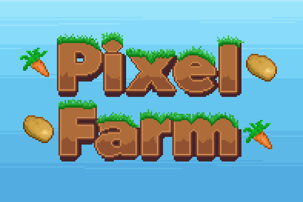

# Pixel Farm

<p align="center">
  
</p>

Pixel Farm is a Twitch chat-driven farming game presented as a transparent browser overlay. Viewers plant and water crops, then cooperate to harvest them. The project includes a Phaser overlay, a Twitch EventSub bot, and an optional mock-chat page for demos.

## Run locally

Requirements: Node.js 18 or newer, npm, a Twitch account, and a Twitch Developer application.

From the repository root:

```bash
cd FarmBot
npm install
cp .env.example .env.local
```

On Windows PowerShell, copy the example with:

```powershell
Copy-Item .env.example .env.local
```

Fill in the required Twitch values in `FarmBot/.env.local`, then start the bot and local web server:

```bash
node bot.js
```

Open the overlay at [http://localhost:8080](http://localhost:8080). In a regular browser it uses a solid blue background; in an OBS Browser Source it detects OBS and uses the transparent, dithered ocean overlay.

The optional mock chat page is at [http://localhost:8080/chat-simulator](http://localhost:8080/chat-simulator). Add it as a separate OBS Browser Source for a demo chat panel. Keep the bot process running while either page is in use.

The overlay loads Phaser 3.90 from jsDelivr, so the browser needs internet access. Port `8080` serves the pages and their local WebSocket connection.

## OBS setup

1. Start the bot with `node bot.js` and leave its terminal running.
2. In OBS, add a **Browser Source** to your scene.
3. Set the URL to `http://localhost:8080/`.
4. Set **Width** to `800` and **Height** to `600` (recommended).

The overlay detects OBS Browser Source through its `window.obsstudio` integration and switches to transparency automatically. To force a mode for testing, append `?background=transparent` or `?background=blue` to the overlay URL. To show the demo chat separately, add another Browser Source with `http://localhost:8080/chat-simulator`.

## Twitch setup

1. Create a Twitch application in the [Developer Console](https://dev.twitch.tv/console) and copy its Client ID.
2. Install and configure the [Twitch CLI](https://dev.twitch.tv/docs/cli/). While signed in as the bot account, generate a user token with the chat scopes and whisper scope:

   ```bash
   twitch token --user-token --scopes "user:read:chat user:write:chat user:manage:whispers"
   ```

   Put the token value in `OAUTH_TOKEN` without an `oauth:` prefix. This token must belong to the account identified by `BOT_USER_ID` and use the same Twitch application as `CLIENT_ID`.
3. Set `CLIENT_ID`, the bot account's numeric ID in `BOT_USER_ID`, and the channel owner's numeric ID in `CHAT_CHANNEL_USER_ID`.
4. Save the file as `FarmBot/.env.local`, then run `node bot.js` from the `FarmBot` directory. Look for `Validated token.` and a successful `channel.chat.message` subscription in the terminal.

To enable real-time new-subscriber flowers and their farm bonuses, authorize a user token belonging to the channel owner with the `channel:read:subscriptions` scope. Add that scope to `OAUTH_TOKEN` when it is already the channel owner's token. If the bot uses its own account token, put the separate channel-owner token in `CHANNEL_OWNER_OAUTH_TOKEN`. Only new subscriptions count; resubscriptions do not. The flower display stops at four frames. The first four unique new subscribers each add 10% crop growth speed and 3 percentage points of shiny chance for the rest of the stream; additional subscribers still count for flowers but do not increase those bonuses. The subscriber bonuses cap at +40% growth speed and +12 percentage points of shiny chance.

To create the separate owner token with Twitch CLI, sign in as the channel owner and run `twitch token --user-token --scopes "channel:read:subscriptions"`, then set its token value as `CHANNEL_OWNER_OAUTH_TOKEN`.

### Twitch permissions

| Feature | Scope | Token |
| --- | --- | --- |
| Read chat commands | `user:read:chat` | Required on `OAUTH_TOKEN` |
| Send public chat replies | `user:write:chat` | Required on `OAUTH_TOKEN` |
| Whisper `!shop` and `!leaderboard` replies | `user:manage:whispers` | Optional on `OAUTH_TOKEN`; without it, private replies do not work |
| Count new subscribers and enable flower bonuses | `channel:read:subscriptions` | Optional broadcaster token; use `CHANNEL_OWNER_OAUTH_TOKEN` if `OAUTH_TOKEN` belongs to a separate bot account |
| Grow all crops on a 500+ bit Cheer | `bits:read` | Optional on `OAUTH_TOKEN`; without it, no Cheer EventSub subscription is created |

For subscriber flowers, the token must belong to `CHAT_CHANNEL_USER_ID`, and Twitch must have granted the scope to the same application as `CLIENT_ID`. The bot validates the token's account ID and scope before subscribing. Twitch's `channel.subscribe` event covers new subscriptions, not resubscriptions. The bot stores each subscriber once per stream, resets subscriber bonuses when a stream starts or ends, shows up to four flower frames, and grants the growth and shiny chance bonuses for up to four unique new subscribers. See Twitch's [EventSub subscription types](https://dev.twitch.tv/docs/eventsub/eventsub-subscription-types/) and [token scopes](https://dev.twitch.tv/docs/authentication/scopes/).

`bits:read` enables the optional 500-bit crop-growth reward. The bot does not need a Twitch Client Secret at runtime. Keep `.env.local` private and do not commit or share its token values.

## Environment variables

The bot loads `.env.local` and `.env` from the current working directory; `.env.local` takes precedence. Run the bot from `FarmBot/` so these files are found. `CLIENT_ID`, `OAUTH_TOKEN`, `BOT_USER_ID`, and `CHAT_CHANNEL_USER_ID` are required. The remaining variables are optional.

| Variable | Required? | Purpose |
| --- | --- | --- |
| `CLIENT_ID` | Yes | Twitch Developer application ID used with the access tokens. |
| `OAUTH_TOKEN` | Yes | Bot user access token. Needs `user:read:chat` and `user:write:chat`; add `user:manage:whispers` for private replies and `bits:read` for the optional Cheer reward. Do not include an `oauth:` prefix. |
| `BOT_USER_ID` | Yes | Numeric Twitch user ID for the account that owns `OAUTH_TOKEN`. |
| `CHAT_CHANNEL_USER_ID` | Yes | Numeric Twitch user ID of the channel owner. |
| `CHANNEL_OWNER_OAUTH_TOKEN` | No | Channel-owner user token with `channel:read:subscriptions`, needed for subscriber flowers when `OAUTH_TOKEN` belongs to a separate bot account. Leave blank if `OAUTH_TOKEN` belongs to the owner and already has this scope. |
| `DYNAMIC_HARVEST` | No (default `false`) | Set to `true`, `1`, `yes`, or `on` to require multiple unique harvest votes based on active chatters. Any other value keeps one-vote harvests. |
| `OPENAI_API_KEY` | No | OpenAI key for generated special crop modifiers and tint colors. OpenAI takes precedence if both AI keys are set. |
| `OPENROUTER_API_KEY` | No | OpenRouter key for generated special crop modifiers and tint colors; used when `OPENAI_API_KEY` is blank. |

When `OPENAI_API_KEY` is set, the bot uses OpenAI with `gpt-4o-mini`. Otherwise, if `OPENROUTER_API_KEY` is set, it uses OpenRouter with `openai/gpt-4o-mini`. If both keys are set, OpenAI takes precedence. If neither key is set, it selects from the local Cosmic, Glitch, Inferno, and Radioactive presets. Special modifiers are only generated after a crop rolls shiny and passes a second 50% chance. The default shiny chance is 15%; a special modified shiny crop has a 5× modifier value multiplier in addition to the 5× shiny multiplier.

## Chat commands

| Command | Behavior |
| --- | --- |
| `!plant <crop> <tile>` | Plant a crop on an empty unlocked tile. Crops: `potato` (free), `carrot` ($75), and `onion` ($150). |
| `!water <tile>` | Water a planted crop to speed up growth. Watering stacks up to 15 times per tile, for up to 5× growth speed. Each chatter has a 15-second watering cooldown; the channel owner bypasses it. |
| `!harvest <tile>` | Vote to harvest a fully grown crop. Each successful harvest produces two crop rewards. `#` before the tile number is optional. |
| `!shop` | Send crop prices, shared bank balance, and island size; the channel owner sees the reply in chat, while other chatters receive a whisper. |
| `!leaderboard` | Send the stream's top three farmers by points and the planter of its highest-value crop, including its weight and modifiers. Replies are public for the channel owner and whispers for other chatters. |

When `DYNAMIC_HARVEST=true`, harvests require unique chatter votes based on active chatters from the preceding five minutes: fewer than 10 chatters requires one vote; 10–149 requires two; each additional 100 chatters adds one vote, up to five required at 350 or more. When disabled, one chatter can harvest as usual. The crop's planter receives 20% of its harvest value as leaderboard points, and the remaining 80% goes to the shared bank.

All crops average about 0.2 kg; heavier crops are worth more. Shiny crops are worth 5× their normal weight-adjusted value. Rare special modifiers add another 5× and appear with a generated or preset tint. A 500-bit Cheer instantly grows all planted crops when the bot has the optional `bits:read` scope.

The farm starts at 1×1 and expands to 2×2 after 10 successful harvests. It currently caps at 2×2; 3×3 expansion is disabled.

## Mock-chat terminal controls

Type these commands into the terminal running `node bot.js`. They change the local demo settings without adding debug buttons to the overlay.

| Terminal command | Behavior |
| --- | --- |
| `mock activity 0-8` | Set mock-chat activity; `0` disables it, and `8` sends actions about every 125 ms. |
| `mock on` / `mock off` | Resume or stop mock activity. |
| `mock shiny` | Toggle the shiny chance between 15% and 50%. |
| `mock size` | Toggle the visual preview between 1×1 and 2×2. This does not change saved farm progression. |
| `mock chatters` | Toggle simulated active chatters between 1 and 50. |
| `mock bits` | Toggle random simulated Cheers of 501–3,000 bits; each grows all planted crops. |
| `mock subs` | Toggle random simulated new subscriptions. They advance flowers and apply the same growth and value bonuses as live subscriber events. |
| `mock events` | Toggle both random Cheers and simulated new subscriptions together. |
| `mock reset` | Stop mock activity and reset the saved farm to 1×1, 100g, empty tiles, and no subscriber bonuses; the leaderboard is kept. |
| `mock status` | Show current activity, shiny chance, preview size, chatter setting, and event toggles. |
| `mock help` | Show the command list. |

The mock chat generates planting, watering, harvest votes, and reactions to heavy, shiny, or specially modified crops. Its simulated messages are displayed on the mock-chat page and are not sent to Twitch.

## Saved data

`FarmBot/farm-state.json` stores the shared bank, harvested-crop count, current island level, crops, tile wetness, and unique subscriber IDs for the active stream. Subscriber tracking and its growth/value bonuses clear when the stream ends or a new stream starts. `FarmBot/leaderboard.json` stores the current stream's planter points and highest-value crop. Twitch stream online/offline events start and clear these statistics; the `mock reset` terminal command resets farm state while keeping the leaderboard.

## Troubleshooting

- **Invalid access token:** Regenerate the bot account token with the required scopes and update `OAUTH_TOKEN`.
- **`!shop` or `!leaderboard` cannot whisper:** Reauthorize the token with `user:manage:whispers`.
- **The 500-bit reward is disabled:** Add `bits:read` to the token and restart the bot.
- **Port 8080 is unavailable:** Stop the other process using that port, then restart Pixel Farm.
- **The overlay stays blank:** Check the terminal for asset or server errors and confirm the browser has internet access for Phaser.

## Built with

Node.js, Twitch EventSub, WebSockets, Phaser 3, and pixel-art assets.
