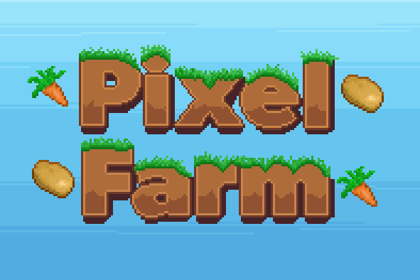

# Pixel Farm

<p align="center">
  
</p>

Pixel Farm is a Twitch chat-driven farming game presented as a transparent browser overlay. Viewers plant and water crops, then cooperate to harvest them. The project includes a Phaser overlay, a Twitch EventSub bot, and an optional mock-chat page for demos.

## Run locally

Requirements: Node.js 18 or newer, npm, a Twitch account, and a Twitch Developer application.

From the repository root:

```bash
cd FarmBot
npm install
cp .env.example .env.local
```

On Windows PowerShell, copy the example with:

```powershell
Copy-Item .env.example .env.local
```

Fill in the required Twitch values in `FarmBot/.env.local`, then start the bot and local web server:

```bash
node bot.js
```

Open the overlay at [http://localhost:8080](http://localhost:8080). For OBS, add that URL as a Browser Source. The farm background is transparent.

The optional mock chat page is at [http://localhost:8080/chat-simulator](http://localhost:8080/chat-simulator). Add it as a separate OBS Browser Source for a demo chat panel. Keep the bot process running while either page is in use.

The overlay loads Phaser 3.90 from jsDelivr, so the browser needs internet access. Port `8080` serves the pages and their local WebSocket connection.

## Twitch setup

1. Create a Twitch application in the [Developer Console](https://dev.twitch.tv/console) and copy its Client ID.
2. Install and configure the [Twitch CLI](https://dev.twitch.tv/docs/cli/). While signed in as the bot account, generate a user token with the chat scopes and whisper scope:

   ```bash
   twitch token --user-token --scopes "user:read:chat user:write:chat user:manage:whispers"
   ```

   Put the token value in `OAUTH_TOKEN` without an `oauth:` prefix. The whisper scope is needed for private `!shop` and `!leaderboard` replies.
3. Set `CLIENT_ID`, the bot account's numeric ID in `BOT_USER_ID`, and the channel owner's numeric ID in `CHAT_CHANNEL_USER_ID`.
4. Save the file as `FarmBot/.env.local`, then run `node bot.js` from the `FarmBot` directory. Look for `Validated token.` and a successful `channel.chat.message` subscription in the terminal.

`bits:read` is optional. Add that scope to the bot token to enable the 500-bit crop-growth reward. Without it, the bot warns that the reward is disabled and continues without the Cheer subscription. The bot does not need a Client Secret at runtime. Do not commit `.env.local` or share its token values.

## Environment variables

The bot loads `.env.local` and `.env` from the current working directory; values already loaded from `.env.local` take precedence. Run the bot from `FarmBot/` so these files are found. The Twitch variables are required; `OPENAI_API_KEY` is optional.

| Variable | Purpose |
| --- | --- |
| `CLIENT_ID` | Twitch Developer application Client ID |
| `OAUTH_TOKEN` | Bot account user access token |
| `BOT_USER_ID` | Numeric Twitch ID for the bot account |
| `CHAT_CHANNEL_USER_ID` | Numeric Twitch ID for the channel owner |
| `OPENAI_API_KEY` | Optional key for generating special crop modifier words and tint colors; leave blank to use built-in presets |

With an OpenAI key, the bot uses `gpt-4o-mini` to generate a one-word modifier and a hex color for a special crop. Without a key, it selects from the local Cosmic, Glitch, Inferno, and Radioactive presets. Special modifiers are only generated after a crop rolls shiny and passes a second 30% chance. The default shiny chance is 10%; a special modified shiny crop has a 5× modifier value multiplier in addition to the 5× shiny multiplier.

## Chat commands

| Command | Behavior |
| --- | --- |
| `!plant <crop> <tile>` | Plant a crop on an empty unlocked tile. Crops: `potato` (free), `carrot` ($75), and `onion` ($250). |
| `!water <tile>` | Water a planted crop to speed up growth. Watering stacks up to 15 times per tile, for up to 5× growth speed. Each chatter has a 15-second watering cooldown; the channel owner bypasses it. |
| `!harvest <tile>` | Vote to harvest a fully grown crop. Each successful harvest produces two crop rewards. `#` before the tile number is optional. |
| `!shop` | Privately send the crop prices, shared bank balance, and island size to the chatter. |
| `!leaderboard` | Privately send the top three farmers by harvest points. |

Harvests require unique chatter votes based on active chatters from the preceding five minutes: fewer than 10 chatters requires one vote; 10–50 requires five; above 50 adds one vote for each additional 10 chatters (rounded up). The crop's planter receives 20% of its harvest value as leaderboard points, and the remaining 80% goes to the shared bank.

All crops average about 0.2 kg; heavier crops are worth more. Shiny crops are worth 5× their normal weight-adjusted value. Rare special modifiers add another 5× and appear with a generated or preset tint. A 500-bit Cheer instantly grows all planted crops when the bot has the optional `bits:read` scope.

The farm starts at 1×1 and expands to 2×2 after 10 successful harvests. It currently caps at 2×2; 3×3 expansion is disabled.

## Mock-chat terminal controls

Type these commands into the terminal running `node bot.js`. They change the local demo settings without adding debug buttons to the overlay.

| Terminal command | Behavior |
| --- | --- |
| `mock activity 0-8` | Set mock-chat activity; `0` disables it, and `8` sends actions about every 125 ms. |
| `mock on` / `mock off` | Resume or stop mock activity. |
| `mock shiny` | Toggle the shiny chance between 10% and 50%. |
| `mock size` | Toggle the visual preview between 1×1 and 2×2. This does not change saved farm progression. |
| `mock chatters` | Toggle simulated active chatters between 1 and 50. |
| `mock status` | Show the current mock activity, shiny chance, preview size, and chatter setting. |
| `mock help` | Show the command list. |

The mock chat generates planting, watering, harvest votes, and reactions to heavy, shiny, or specially modified crops. Its simulated messages are displayed on the mock-chat page and are not sent to Twitch.

## Saved data

`FarmBot/farm-state.json` stores the shared bank, harvested-crop count, crops, and tile wetness. `FarmBot/leaderboard.json` stores planter points across runs. Back up these files before manually resetting farm progress.

## Troubleshooting

- **Invalid access token:** Regenerate the bot account token with the required scopes and update `OAUTH_TOKEN`.
- **`!shop` or `!leaderboard` cannot whisper:** Reauthorize the token with `user:manage:whispers`.
- **The 500-bit reward is disabled:** Add `bits:read` to the token and restart the bot.
- **Port 8080 is unavailable:** Stop the other process using that port, then restart Pixel Farm.
- **The overlay stays blank:** Check the terminal for asset or server errors and confirm the browser has internet access for Phaser.

## Built with

Node.js, Twitch EventSub, WebSockets, Phaser 3, and pixel-art assets.
